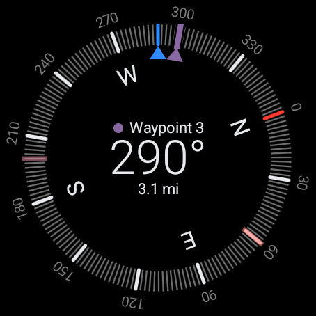

# compass

A compass for Wear OS that also saves GPS positions as waypoints and shows the direction and distance to each one on the dial.



The picture is the compass screen on an emulator with three waypoints, a simulated position, and the heading at 290 degrees. The screens and states an emulator can produce are pictured in [docs/screenshots](docs/screenshots/README.md), which also lists the ones it cannot. Everything in this file was seen on emulators; the app has not been run on a physical watch.

## The three screens

Settings, the compass and the waypoints are three screens side by side in one row that wraps around. The app opens on the compass. A swipe left from the compass shows the waypoints, a swipe right shows settings, and a second swipe the same way reaches the other one. Three ticks show which screen is in view: at the bottom edge on settings and waypoints, and on the compass for about a second around a swipe.

| Where | Gesture | What happens |
|-|-|-|
| Any of the three | Crown press | Leaves the app (the system's crown press) |
| Any of the three | Back | Moves one screen toward settings (compass to settings, settings to waypoints, waypoints to compass); never leaves the app |
| Compass | Side button, single press | Saves the current position as a waypoint (or drops a crumb while a trail is being laid) |
| Compass | Side button, double press | With `Breadcrumb trail` on: starts a trail, or switches between laying and retracing |
| Compass | Swipe up or down, or turn the crown | Moves the focus among the targets |
| Compass | Long press | Opens the waypoints screen |
| Compass | Tap | Nothing |
| Waypoints | Side button | Saves a waypoint, as on the compass |
| Waypoints | Tap `Log here` | Saves a waypoint |
| Waypoints | Tap a row | Sets or clears that waypoint as a target |
| Waypoints | Long press a row | Opens its edit screen |
| Waypoints | Tap the header | Sets all waypoints as targets, or clears all if all are |
| Waypoints | Tap the `Trail` row | With `Breadcrumb trail` on: does what a double press does |
| Waypoints | Hold the `Trail` row | Clears the trail (`Hold to clear`) |
| Waypoints | Tap `Drop crumb` (shown while a trail is being laid) | Drops a crumb, as a single press of the side button does then |
| Edit | Drag along the color ring, or turn the crown | Changes the waypoint's color |
| Edit | Tap the name | Opens the system's text input to rename it |
| Edit | Tap the `Target` tick | Sets or clears it as a target |
| Edit | Hold `Hold to delete` for about a second | Deletes the waypoint and closes the screen |
| Edit, calibration | Right swipe, or Back | Returns to the screen it was opened from |
| Settings | Tap a row | Switches it |

The side button does nothing on settings, edit and calibration. Whether a physical watch delivers a single or a double press of its side button to an app was not tested; `Log here`, the `Trail` row and the `Drop crumb` row do the same things from the waypoints screen.

## Compass

- The dial turns so its north points to north: fine ticks every 2 degrees, heavier ticks every 30, degree labels outside the ticks, N, E, S and W inside, a north tick, and a fixed pointer at 12 o'clock. The heading is shown as a whole number in the middle. `MAG` shows when the dial is on magnetic north.
- True or magnetic north is a setting. True north uses the declination for the last known position; with no position ever known, the dial shows magnetic north and `MAG`.
- When the watch is tilted steeply (it begins past 70 degrees and ends below 60), the heading is not taken: the dial dims and a looping drawing of a watch turning level appears with `Hold flat`.
- The `Calibrate` prompt appears when the magnetometer reports low or unreliable accuracy, and opens the calibration screen.
- With `Show coordinates` on, the latitude (for example `43.7022° N`) is at the top of the readout and the longitude (`72.2896° W`) at the bottom. They are not shown in the hold-flat state or without the location permission. Before a position is known the latitude is absent and the longitude's place shows `Locating…`, or `Location is off` with location switched off, unless the distance's row or a logging result already says why there is no position.
- A waypoint name that does not fit slides back and forth in its place. With the system's animations removed it ends in an ellipsis.
- The heading sensor runs while the compass is on screen or calibration is open, and stops about 2 seconds after.

## Saving a waypoint

A single press of the side button on the compass or the waypoints screen saves the current position without leaving the screen. The status under the heading reads `Saving…` with the accuracy, then `Saved Waypoint N` in green with a confirming tap, or a failure in the error color: `No GPS fix`, `Location is off`, `Needs access to precise location`, or `Couldn't save`.

- A fix with accuracy of 15 m or better is saved at once. After 20 seconds the best fresh fix is saved, or `No GPS fix` is shown when there is none. A fix from before the press is never saved.
- The first press asks for precise and approximate location; if only approximate is granted, nothing is saved and `Needs access to precise location` shows.
- New waypoints are named `Waypoint N`, are targets, and get a color automatically.

## Targets

- Any number of waypoints can be targets at once. Each target is a line across the ring at its bearing. The focused target (shown by name, with its color's dot) has its full color, a casing, and an arrow like the pointer's; the others are soft tints at 60 percent opacity.
- A waypoint's color is the color at its place on a ring that fades between three colors: the accent (the pointer), the north color and the error color. On API 35 and newer, while the system's dynamic color setting (`dynamic_color_theme_enabled`) is on, the app reads the system's color scheme; if the scheme's main color is not too pale or gray, those three follow it. Otherwise they are blue, red and red. On the emulators that setting was off until switched on by hand, and no emulator was found on which the watch face changes the scheme. With blue, red and red, a third of the ring is one red.
- The distance is under the heading, in meters and kilometers or feet and miles. A target under 10 m (30 ft) away shows `Arrived at target` and has no line or arrow; it counts as left again only beyond 12 m (36 ft). A distance from a fix more than 20 seconds old is marked `(old)`.
- When the heading is within 2 degrees of the focused target (held until it is more than 3 degrees off), its line is drawn thicker at 12 o'clock.
- While a target exists, the location permission is held and the app is on screen, position updates come about every 5 seconds, on any of the three screens. The screen stays awake while a target exists and the compass is in view, with or without a position.
- Targets and the focus are stored and survive closing the app.

## Blind navigation

On by default. When the heading comes within 2 degrees of the focused target there is one strong haptic pulse, then a soft one about once a second while the wearer keeps facing it. It is silent in the hold-flat state, while the compass is not the screen in view, with no focused target, and while the position is old (a fix more than 20 seconds old). The pulses are the system's haptic feedback calls (`CONFIRM` and `CONTEXT_CLICK`), with no vibration permission; they follow the watch's touch-vibration setting. Their feel on a watch was not tested.

## Breadcrumb trail

Off by default (`Breadcrumb trail` in settings). With it on:

1. A double press with no trail starts one; the compass shows `Trail` and the crumb count.
2. While laying, each single press drops a crumb at the current position, with the same fix rules as saving a waypoint, and so does a tap on the `Drop crumb` row, which the waypoints screen shows under the `Trail` row while a trail is being laid. Waypoints can still be saved from `Log here`.
3. A double press switches to retracing: the newest crumb is shown like a focused target (`Crumb N`) with its direction and distance.
4. A crumb is deleted and the next newest takes over when a fix of 15 m or better is within 10 m (30 ft) of it while the compass is the screen at rest in view and the app is in front. After the last, `Trail complete` shows and the trail is off.
5. A double press while retracing returns to laying with the remaining crumbs.

Crumbs are stored separately from waypoints, are never listed with them except as the one `Trail` row, and survive closing the app. While a trail is retraced the waypoint focus is suspended and returns afterwards.

## Settings

| Row | Default | Smaller line |
|-|-|-|
| True north | on | `Off: magnetic north` |
| Feet and miles | from the watch's locale | `Off: meters and km` |
| Tick feedback | on | `Faint tap at each tick mark` |
| Blind navigation | on | `Pulses when facing the target` |
| Breadcrumb trail | off | `Double press starts a trail` |
| Show coordinates | off | `GPS position on the compass` |
| Back up waypoints | on | `With this watch's backup` |

`Calibrate` shows the accuracy the magnetometer last reported (`High`, `Medium`, `Low`, `Unreliable`) and opens the calibration screen: a figure-8 guide, the accuracy level, the field strength in microtesla, a frame that fills by quarters as accuracy improves, and a warning with the frame filled in the error color while the field is below 25 or above 65 microtesla. The last line shows the version and `MIT License`.

The text of the settings, the waypoints list, the edit screen and the calibration screen follows the system's font size (on the emulators the setting has six steps, from 0.94 to 1.24; a scale outside 0.85 to 1.24 is drawn at the nearer end). The compass's text does not: it is sized from the dial.

A tap on `Back up waypoints` while it is on opens a question (`Turn off backup?`, with `Keep on` and `Turn off`); Back and a right swipe leave it on.

Turning on `Show coordinates` without location access asks for it; if precise location is not granted the switch stays off and `Needs access to precise location` shows under it.

## Backup

The waypoint database (`waypoints.db`, which also holds the crumbs) and the settings file are the only data of the wearer's included in the system's backup and in device-to-device transfer; while the switch is off because the wearer turned it off, a backup or a transfer is handed one marker file instead, which holds the words `Back up waypoints is off.` and nothing else; when that backup or transfer is restored the switch is off. The last known position is kept in a separate file that is not included. The system does the backing up and the transferring. The `Back up waypoints` switch is checked each time the system asks for a backup; with it off the app hands over neither of them. The database and the settings file are handed to a cloud backup only when the watch can encrypt it end to end, which needs a screen lock; the marker file and device-to-device transfer do not depend on that. When a waypoint is deleted, the app overwrites its content in the database file. A waypoint deleted on the watch is removed from the app's storage. A backup made before the deletion can still contain it until a newer backup replaces it. A backup is restored when the app is installed: after it is uninstalled and installed again, or when a new or reset watch is set up. The app cannot restore a backup while it is running. A restore replaces the waypoint list with the one in the backup; waypoints logged after that backup are not kept. If the switch is turned off and the app is uninstalled before the system has made another backup, installing it again restores the earlier backup: its waypoints are back and the switch is on. Only the emulator's local backup transport was exercised, also for a pass that says it is a device-to-device transfer; Google's backup service and a transfer between two devices were not.

## Versions

Minimum API level 33 (Wear OS 4), target 35, compiled against 37. The manifest requires a watch with a compass sensor; GPS hardware is not required. Test runs: emulators at API 33, 34, 35 and 37. No physical watch has been used.

## Building

Needs JDK 17 and the Android SDK (`local.properties` with `sdk.dir`, which Android Studio writes). From the repository root:

```
./gradlew assembleDebug
./gradlew installDebug
```

`installDebug` installs on the single attached device or emulator. The release build type shrinks the app and is signed from `keystore.properties` when that file exists (the file and keystores are ignored by git).

## Tests

Unit and instrumented tests, and the scripts that run them on the emulators, are described in [docs/TESTING.md](docs/TESTING.md). The design is in [docs/superpowers/specs/2026-10-11-wear-compass-v2-redesign.md](docs/superpowers/specs/2026-10-11-wear-compass-v2-redesign.md) and [the first spec](docs/superpowers/specs/2026-10-11-wear-compass-design.md).

## License

MIT; see [LICENSE](LICENSE).
